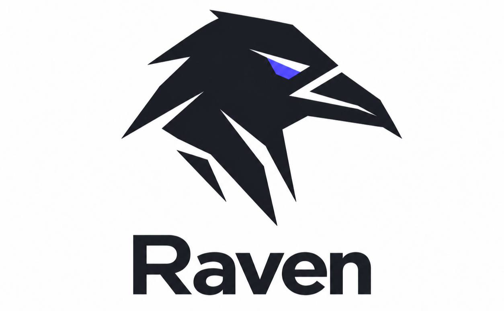

<p align="center">
  
</p>

# Raven

Uma skill para questionar a raiz de um problema, testar premissas e construir um caminho conforme as respostas, com fechamento confirmado pelo usuário e plano Markdown opcional.

O fluxo combina a entrevista em rodadas da `grilling` com a síntese documental da `to-spec`, em uma única skill independente. Nenhuma delas precisa estar instalada.

## Instalação

Com o CLI Skills:

```sh
npx skills add nihilboy1/raven --skill raven
```

Selecione o agente e o escopo de instalação desejados no instalador.

Para instalar manualmente no Codex, copie `SKILL.md` e a pasta `agents/` deste repositório para `~/.codex/skills/raven/`. Se `CODEX_HOME` estiver definido, use sua pasta `skills/raven/`. Preserve eventuais personalizações de uma instalação anterior antes de substituí-la.

## Uso

No Codex:

```text
$raven Os usuários estão perdendo prazos. Quero entender a causa e discutir se notificações resolveriam.
```

Também é possível pedir em linguagem natural:

```text
#raven Quero colocar esta ideia à prova e alinhar um caminho antes de implementar.
```

`$raven` é a invocação de skill; `#raven` é um texto reconhecido pelas instruções da skill, não um comando especial do aplicativo.

## Como funciona

1. Consulta as instruções do projeto e investiga os fatos relevantes.
2. Separa sintomas, hipóteses e evidências; investiga quem enfrenta o problema, seu impacto e o resultado esperado.
3. Usa subagentes para buscas independentes quando disponíveis e permitidos.
4. Testa premissas, riscos e alternativas e adapta as perguntas e recomendações às respostas, sem conduzir a uma solução predeterminada.
5. Quando considera o escopo definido, resume o entendimento e pergunta se está correto e podem fechar.
6. Pergunta separadamente se você quer salvar ou atualizar um `.md` ou encerrar somente no chat. Grava o plano apenas quando autorizado e apresenta o arquivo para revisão.

As perguntas são organizadas por dependência: decisões independentes podem aparecer na mesma rodada; as que dependem de respostas anteriores ficam para depois. A skill aguarda suas respostas antes de avançar e não pergunta por fatos que consegue verificar no ambiente. Recomendações incluem o motivo ou a principal consequência da escolha.

O objetivo é colocar a proposta à prova antes de fechar um caminho, considerando inclusive soluções mais simples ou não implementar. Confirmar o escopo não autoriza automaticamente gravar um arquivo ou iniciar a implementação. Você pode encerrar somente no chat; se quiser o documento, basta responder, sem outro comando. Se pedir o arquivo antes de resolver todas as decisões, recebe um rascunho com as pendências explícitas.

Na primeira resposta de cada execução, a skill se apresenta com 🐦‍⬛ **Raven**, sem repetir a apresentação nas rodadas seguintes ou ao retomar o mesmo planejamento. No chat, cada decisão aparece em um bloco próprio, com 🔎 **Pergunta** e 💡 **Recomendação** separadas por uma linha em branco. Alternativas ficam em itens separados; ✅ identifica decisões alinhadas, 📄 apresenta contexto e 🟪 destaca pendências quando necessário. Esse padrão de comunicação não altera o modelo do plano salvo.

A entrevista acontece exclusivamente por texto no chat. A skill não usa ferramentas de perguntas do Codex ou de outras plataformas, nem abre popups, formulários ou seletores interativos para coletar respostas ou aprovações.

## Fechamento da conversa

O agente propõe o fechamento quando problema, resultado esperado, caminho, limites e critérios de sucesso estão suficientemente definidos, sem decisões materiais em aberto. Não prolonga a entrevista por detalhes rotineiros.

O resumo de fechamento reúne o problema, a causa sustentada ou hipótese ainda incerta, o resultado esperado, o caminho proposto, o escopo, as exclusões e eventuais riscos ou pendências. Depois, apresenta duas perguntas separadas, por exemplo:

> 🔎 **Confirmar escopo:** esse resumo corresponde ao que você quer? Podemos fechar assim?
>
> 🔎 **Salvar documento:** quer que eu salve esse entendimento em `.md` ou prefere encerrar somente no chat?

Se você corrigir algo, a skill retoma os pontos afetados e apresenta o resumo revisado. Se responder apenas a uma das perguntas, ela esclarece somente a outra, aproveitando autorizações já dadas. Confirmar o fechamento e dispensar o documento encerra o fluxo sem criar ou alterar um plano.

## Estrutura do plano opcional

- Problema e solução.
- Histórias de uso.
- Decisões de implementação e de teste.
- Fora do escopo.
- Critérios de aceite.
- Etapas de implementação e dependências.
- Questões abertas e notas relevantes.

O plano segue o idioma da conversa e as convenções documentais do projeto. Na ausência delas, usa `docs/plans/<nome-descritivo-em-ingles>.md`.

## Limites

A skill conduz o planejamento crítico e grava Markdown local quando solicitado ou autorizado. Implementação, publicação, commits e escritas em banco dependem de uma etapa posterior e das autorizações do projeto. Ela não concede permissões adicionais nem substitui os SSOTs existentes.

O comportamento depende do agente e das ferramentas disponíveis. A skill não exige um servidor MCP específico nem as skills de origem.

## Manutenção

`SKILL.md` é a fonte das instruções e do modelo do plano. `agents/openai.yaml` contém os metadados de apresentação no Codex. Alterações neste repositório não atualizam automaticamente cópias já instaladas; reinstale ou sincronize os arquivos após revisar as mudanças.

## Validação

O workflow `.github/workflows/validate-skill.yml` executa a validação em pushes, pull requests e acionamentos manuais no GitHub Actions. O validador fica em `scripts/quick_validate.py`, adaptado do `skill-creator` do Codex, sem depender da instalação local do aplicativo.

Para executar localmente, na pasta do repositório:

```sh
python -m venv .venv
```

No PowerShell:

```powershell
.\.venv\Scripts\python.exe -m pip install -r requirements-dev.txt
.\.venv\Scripts\python.exe -X utf8 scripts/quick_validate.py .
```

Em Linux ou macOS:

```sh
.venv/bin/python -m pip install -r requirements-dev.txt
.venv/bin/python -X utf8 scripts/quick_validate.py .
```

A validação verifica o frontmatter, as regras de nome e descrição e placeholders inacabados. Ela não avalia o comportamento da entrevista. A pasta `.venv/` é ignorada pelo Git.

## Créditos e licença

Adaptação por [nihilboy1](https://github.com/nihilboy1), baseada nos fluxos de [grilling](https://github.com/mattpocock/skills/tree/main/skills/productivity/grilling) e [to-spec](https://github.com/mattpocock/skills/tree/main/skills/engineering/to-spec), de Matt Pocock.

Distribuída sob a [licença MIT](LICENSE), preservando os créditos da origem.
